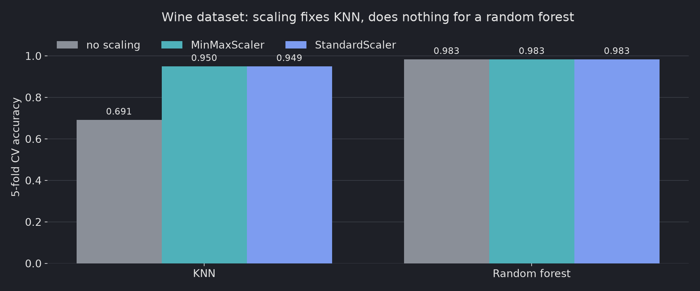
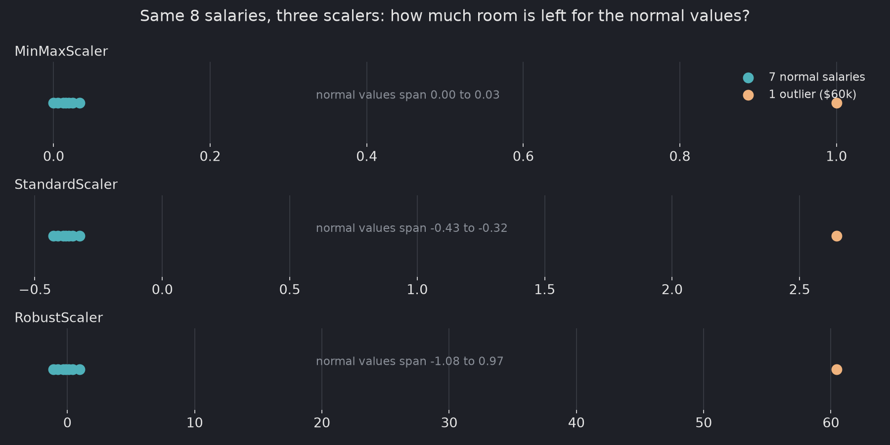

# MinMaxScaler vs StandardScaler: which scaler should you use?

Use standardization (`StandardScaler`) as the default for distance- and gradient-based models such as KNN, SVM,
linear models and PCA. Use min-max scaling (`MinMaxScaler`) when a model or input format needs values in a fixed
range such as 0 to 1. One extreme value squeezes the normal values together under both; `RobustScaler` handles
that case. Tree-based models don't need scaling at all.

The examples below ran on 2026-09-28 with scikit-learn 1.9.1, NumPy 2.5.3 and Python 3.12.

## Two formulas, applied per column

Min-max scaling asks "where is this value between the smallest and the largest?" and computes
`(x - min) / (max - min)`. Standardization asks "how many standard deviations is this value from the mean?" and
computes `(x - mean) / std`.

| | Min-max scaling | Standardization |
|---|---|---|
| scikit-learn class | `MinMaxScaler` | `StandardScaler` |
| Formula | `(x - min) / (max - min)` | `(x - mean) / std` |
| Output range | Fixed, 0 to 1 by default | Not fixed, usually about -3 to 3 |
| Uses | The two most extreme values | Every value, through the mean and std |
| Good fit | Pixel values, bounded inputs, neural nets expecting 0–1 | Default for KNN, SVM, linear and logistic regression, PCA |

Each feature is scaled on its own, as the [scikit-learn preprocessing guide](https://scikit-learn.org/stable/modules/preprocessing.html)
describes. A quick check with three columns on different scales:

```python
import numpy as np
from sklearn.preprocessing import MinMaxScaler

data = np.array([[1, 0.1, 0.3], [4, 6.7, 6.0], [7, 18.0, 29.0]])
print(MinMaxScaler().fit_transform(data).round(3))
```

```
[[0.    0.    0.   ]
 [0.5   0.369 0.199]
 [1.    1.    1.   ]]
```

Every **column** now runs from 0 to 1. The rows do not.

## Scaling lifts KNN on the wine dataset

Models that compare distances or use gradient descent need scaling. A tree only asks "is this value above a
threshold?", and scaling keeps the order of values, so tree-based models come out the same.

The wine dataset is a good test: `magnesium` ranges from 70 to 162, while `proline` ranges from 278 to 1680.
Without scaling, `proline` dominates every distance.

```python
from sklearn.datasets import load_wine
from sklearn.ensemble import RandomForestClassifier
from sklearn.model_selection import cross_val_score
from sklearn.neighbors import KNeighborsClassifier
from sklearn.pipeline import make_pipeline
from sklearn.preprocessing import MinMaxScaler, StandardScaler

X, y = load_wine(return_X_y=True)

models = {"KNN": KNeighborsClassifier(), "Random forest": RandomForestClassifier(random_state=0)}
scalers = {"no scaling": None, "MinMaxScaler": MinMaxScaler(), "StandardScaler": StandardScaler()}

for model_name, model in models.items():
    for scaler_name, scaler in scalers.items():
        pipe = make_pipeline(scaler, model) if scaler else model
        acc = cross_val_score(pipe, X, y, cv=5).mean()
        print(f"{model_name:>13} | {scaler_name:<14} | accuracy {acc:.3f}")
```

```
          KNN | no scaling     | accuracy 0.691
          KNN | MinMaxScaler   | accuracy 0.950
          KNN | StandardScaler | accuracy 0.949
Random forest | no scaling     | accuracy 0.983
Random forest | MinMaxScaler   | accuracy 0.983
Random forest | StandardScaler | accuracy 0.983
```



Scaling lifts KNN from **0.691 to 0.950**. The random forest scores **0.983** either way.
On this dataset, the choice between the two scalers barely matters (0.950 vs 0.949). Scaling at all is what moved the score.

The scaler sits inside `make_pipeline`, so it is fitted on the training folds only. Fitting it on the full
dataset before splitting leaks information from the test data.

## One outlier squeezes both MinMaxScaler and StandardScaler

Here are eight monthly salaries (in $1,000) with one extreme value:

```python
import numpy as np
from sklearn.preprocessing import MinMaxScaler, StandardScaler, RobustScaler

salary = np.array([[3.1], [3.4], [3.8], [4.0], [4.2], [4.5], [5.0], [60.0]])

for scaler in [MinMaxScaler(), StandardScaler(), RobustScaler()]:
    out = scaler.fit_transform(salary).ravel()
    print(f"{type(scaler).__name__:>14}: {np.round(out, 2)}")
```

```
  MinMaxScaler: [0.   0.01 0.01 0.02 0.02 0.02 0.03 1.  ]
StandardScaler: [-0.43 -0.41 -0.39 -0.38 -0.37 -0.35 -0.32  2.64]
  RobustScaler: [-1.08 -0.76 -0.32 -0.11  0.11  0.43  0.97 60.43]
```



- **MinMaxScaler** squeezes the seven normal salaries into **0.00–0.03**. The outlier takes the whole range.
- **StandardScaler** squeezes them into **-0.43 to -0.32**. The outlier inflates the standard deviation, so everything else shrinks.
- **RobustScaler** keeps them spread from **-1.08 to 0.97**. It uses the median and the interquartile range, which one extreme value can't move.

The scikit-learn example [comparing scalers on data with outliers](https://scikit-learn.org/stable/auto_examples/preprocessing/plot_all_scaling.html)
shows the same effect on the California housing data.

## Which scaler should you choose?

| Situation | Use |
|---|---|
| Tree-based model (decision tree, random forest, gradient boosting) | No scaling needed |
| KNN, SVM, linear or logistic regression, PCA, neural networks | `StandardScaler` as the default |
| You need a fixed range, e.g. 0–1 inputs or image pixels | `MinMaxScaler` |
| The feature has outliers you want to keep | `RobustScaler` |

## Mistakes that undo the scaling

- Fitting the scaler on all data before the train/test split. Fit on the training data only, or use a `Pipeline`.
- Scaling a single 1-D array. Scalers expect 2-D input, so use `x.reshape(-1, 1)`.
- Expecting `StandardScaler` to handle outliers. As the salary example shows, it squeezes them too. Use `RobustScaler` or deal with the outliers first.
- Calling `fit_transform()` on validation, test or production data. Fit once on training data and call `transform()` everywhere else.

The `fit`, `transform` and `inverse_transform` steps of a single scaler are covered in
[How to use MinMaxScaler in scikit-learn](/blog/2026-10-12-minmaxscaler_sklearn/).
