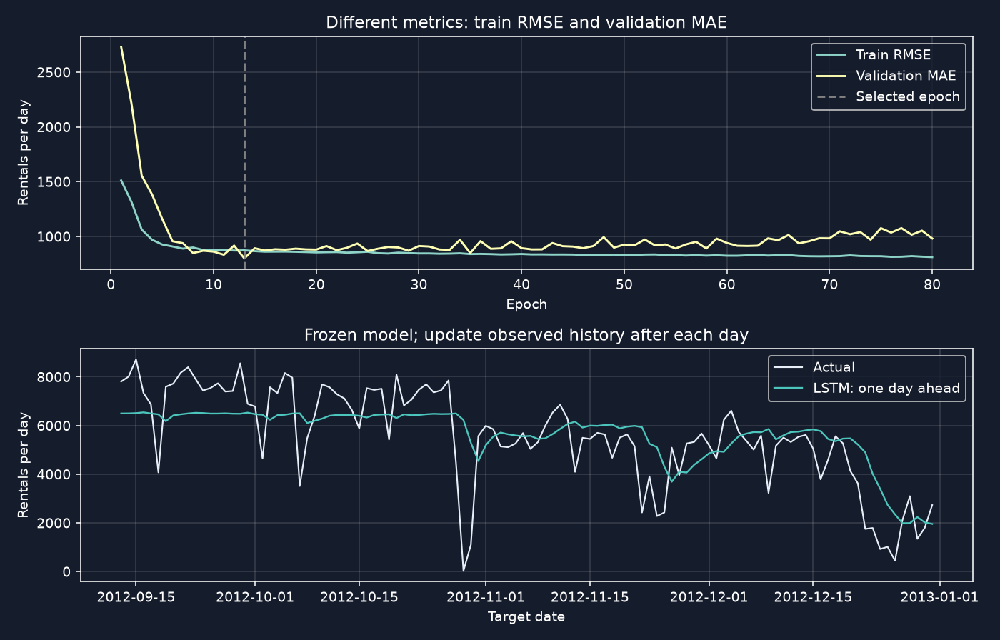
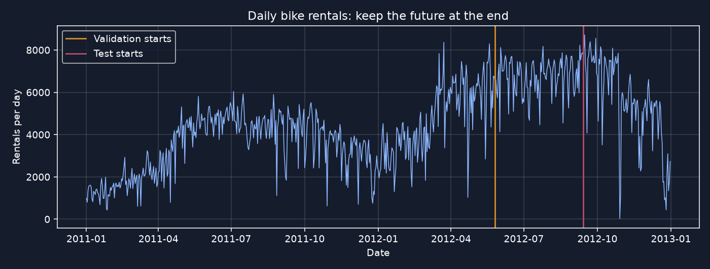
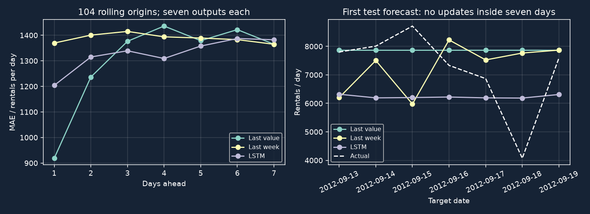

# Your first LSTM forecast in PyTorch: from CSV to predictions

A small LSTM takes **14 days of bike rentals and predicts the
next day**, with plots and an error score you can check against a simple rule. No GPU, account or API key is needed.
Basic Python, arrays and the idea of a training set are enough to follow along.

Here is the result before the code: on the final 110 days, the LSTM missed by **1,117 rentals per day** on average.
Predicting yesterday's value missed by **927**. The network trained successfully; it was not the better forecaster.
The comparison gives the trained network a useful forecasting check.



This is **rolling one-day-ahead
prediction**: after each day finishes, its actual count becomes available for tomorrow's input. Forecasts advance
one day at a time over all 110 days, and the model weights stay fixed throughout the test period.

## 1. Prepare a small CPU environment

_Tested on 2026-10-28 with Python 3.12.13, PyTorch 2.14.0, NumPy 2.5.4, pandas 3.0.6, scikit-learn 1.9.1 and
Matplotlib 3.11.0 on macOS, Apple M5. Training the 80 epochs took about 0.9 seconds on one CPU thread. A cold
end-to-end run, including imports, download and plots, took 27 seconds and peaked at about 459 MiB resident memory;
package installation is not included. Runtime varies with the machine._

Download [`lstm_tutorial.py`](/assets/code/lstm_forecasting_tutorial/lstm_tutorial.py) and
[`requirements.txt`](/assets/code/lstm_forecasting_tutorial/requirements.txt) into an empty working folder. With
Python 3.12 installed, the macOS/Linux terminal commands are:

```bash
python3.12 -m venv .venv
source .venv/bin/activate
python -m pip install -r requirements.txt
python lstm_tutorial.py
```

The script downloads the data on its first run and writes its CSVs and PNGs under `results/`. No notebook is required.
The instructions below are the same computation split into steps: run every Python block in order in one process,
or put them in one file. The downloaded script adds version logging and the final combined plot.

```python
import copy
import io
import time
import urllib.request
import zipfile
from pathlib import Path

import matplotlib
matplotlib.use("Agg")
import matplotlib.pyplot as plt
import numpy as np
import pandas as pd
import torch
from sklearn.preprocessing import StandardScaler
from torch import nn
from torch.utils.data import DataLoader, TensorDataset

WINDOW, EPOCHS = 14, 80
OUT = Path("results")
OUT.mkdir(parents=True, exist_ok=True)
torch.manual_seed(0)
np.random.seed(0)
torch.set_num_threads(1)
torch.use_deterministic_algorithms(True)
plt.style.use("dark_background")
plt.rcParams.update({"figure.figsize": (10, 3.8), "axes.grid": True,
                     "figure.facecolor": "#151c2c", "axes.facecolor": "#151c2c",
                     "grid.alpha": 0.15})
```

`Agg` saves plots without a desktop display. Open the PNG files to inspect them. CPU execution and fixed seeds make
this run easier to reproduce, but PyTorch does not promise identical results across platforms and releases.

## 2. Download and inspect the daily CSV

Use the [UCI Bike Sharing dataset](https://archive.ics.uci.edu/dataset/275/bike+sharing+dataset), credited to
Hadi Fanaee-T (2013), DOI [10.24432/C5W894](https://doi.org/10.24432/C5W894), under **CC BY 4.0**.
The archive contains both hourly and daily data. We use `day.csv`: 731 consecutive dates from 2011–2012.

The target, `cnt`, is the total number of daily rentals. Use **only past counts** as inputs. Do not add the
same day's `casual` and `registered` columns: their sum is the answer. Weather and calendar features can wait until
the basic pipeline works.

```python
URL = "https://archive.ics.uci.edu/static/public/275/bike+sharing+dataset.zip"
archive = OUT / "bike_sharing.zip"
if not archive.exists():
    request = urllib.request.Request(URL, headers={"User-Agent": "LSTM-Tutorial/1.0"})
    with urllib.request.urlopen(request, timeout=60) as response:
        archive.write_bytes(response.read())
with zipfile.ZipFile(io.BytesIO(archive.read_bytes())) as zipped:
    df = pd.read_csv(zipped.open("day.csv"), parse_dates=["dteday"])
df = df.sort_values("dteday").set_index("dteday")
assert df.index.is_unique and df.index.is_monotonic_increasing
assert df.index.to_series().diff().iloc[1:].eq(pd.Timedelta(days=1)).all()
assert df["cnt"].notna().all() and df["cnt"].ge(0).all()
values = df[["cnt"]].to_numpy(dtype=np.float32)
train_end, val_end = int(len(df) * 0.70), int(len(df) * 0.85)
print(f"Rows: {len(df)}; {df.index[0].date()} to {df.index[-1].date()}")
print(f"Rows before windowing: train={train_end}, "
      f"validation={val_end - train_end}, test={len(df) - val_end}")
```

```text
Rows: 731; 2011-01-01 to 2012-12-31
Rows before windowing: train=511, validation=110, test=110
```

The assertions matter: 14 rows mean 14 days only if dates are consecutive. If a check fails on another dataset,
investigate the missing or duplicate dates instead of silently filling future values into the past.

## 3. Look at the timeline before training

```python
fig, ax = plt.subplots()
ax.plot(df.index, values[:, 0], lw=0.8, color="#8cb8ff")
ax.axvline(df.index[train_end], color="#d18a26", label="Validation starts")
ax.axvline(df.index[val_end], color="#b54966", label="Test starts")
ax.set(xlabel="Date", ylabel="Rentals per day", title="Daily bike rentals: keep the future at the end")
ax.legend()
fig.tight_layout()
fig.savefig(OUT / "timeline.png", dpi=140)
plt.close(fig)
```



Demand changes across seasons and between the two years. A shuffled split would mix those periods together;
instead, the earliest 70% is training, the next 15% is validation, and the remainder is test. Validation chooses the
checkpoint. Test measures that choice on later dates; it does not choose the model or epoch.

## 4. Turn the series into input windows

Fit the scaler on **training rows only**, then apply that same transformation everywhere. We scale the target
series as well, so predictions must later be converted back to rentals per day.

Build each input from rows `t-14` through `t-1`, with row `t` as its target. Assign windows to splits by their
**target date** to keep the split chronological.

```python
scaler = StandardScaler().fit(values[:train_end])
scaled = scaler.transform(values).astype(np.float32)
target_idx = np.arange(WINDOW, len(values))
X = np.stack([scaled[t - WINDOW:t] for t in target_idx])
y = scaled[target_idx]
assert X.shape == (len(df) - WINDOW, WINDOW, 1)
assert np.array_equal(X[0, :, 0], scaled[:WINDOW, 0])
assert y[0, 0] == scaled[WINDOW, 0]
masks = [target_idx < train_end,
         (target_idx >= train_end) & (target_idx < val_end),
         target_idx >= val_end]
(X_train, y_train), (X_val, y_val), (X_test, y_test) = [
    (torch.from_numpy(X[m]), torch.from_numpy(y[m])) for m in masks
]
print("Train:", tuple(X_train.shape), tuple(y_train.shape))
print("Validation:", tuple(X_val.shape), tuple(y_val.shape))
print("Test:", tuple(X_test.shape), tuple(y_test.shape))
print(f"First window: {df.index[0].date()} to {df.index[WINDOW - 1].date()} "
      f"-> target {df.index[WINDOW].date()}")
```

```text
Train: (497, 14, 1) (497, 1)
Validation: (110, 14, 1) (110, 1)
Test: (110, 14, 1) (110, 1)
First window: 2011-01-01 to 2011-01-14 -> target 2011-01-15
```

The training set loses its first 14 dates because they have no complete history. The first validation window can
use the final 14 training days, and the first test window can use the final 14 validation days: these values are
already known at their forecast origins. Later test windows use earlier **observed** test counts, never the target
day itself. That is why this is a daily-updated one-step evaluation.

Each input has shape `(samples, 14, 1)`: samples, timesteps, features. For the dimension rules and the
`batch_first` pitfall, see [LSTM input shape explained](/blog/2026-10-05-lstm_input_shape/).

## 5. Define the smallest useful training model

```python
class DailyLSTM(nn.Module):
    def __init__(self):
        super().__init__()
        self.lstm = nn.LSTM(input_size=1, hidden_size=16, batch_first=True)
        self.head = nn.Linear(16, 1)

    def forward(self, x):
        sequence, _ = self.lstm(x)
        return self.head(sequence[:, -1, :])

model = DailyLSTM()  # CPU; no hidden state is carried between windows.
loader = DataLoader(TensorDataset(X_train, y_train), batch_size=32, shuffle=True)
optimizer = torch.optim.Adam(model.parameters(), lr=0.003)
loss_fn = nn.MSELoss()
print("Parameters:", sum(p.numel() for p in model.parameters()))
```

```text
Parameters: 1233
```

The LSTM produces 16 hidden values at each timestep. Take the final timestep, then use a linear layer to produce
one standardized count. The single-layer, unidirectional network starts with randomly initialized weights.

`shuffle=True` reorders **training windows** within their assigned split. It is appropriate here because
every window starts with a fresh hidden state. Carrying state between batches would need a different loader and
training design; it is outside this tutorial.

## 6. Train and keep the checkpoint that validation selects

Training minimizes mean squared error (MSE) on standardized counts. After each epoch, measure validation mean
absolute error (MAE), without gradients, and keep the best weights. Copy the state: retaining only a reference to
the live parameters would not preserve an earlier checkpoint.

```python
history = []
best_val, best_epoch, best_state = float("inf"), 0, None
started = time.perf_counter()
for epoch in range(1, EPOCHS + 1):
    model.train()
    total = 0.0
    for xb, yb in loader:
        optimizer.zero_grad()
        prediction = model(xb)
        loss = loss_fn(prediction, yb)
        loss.backward()
        optimizer.step()
        total += loss.item() * len(xb)
    model.eval()
    with torch.no_grad():
        val_mae = (model(X_val) - y_val).abs().mean().item()
    history.append([epoch, total / len(X_train), val_mae])
    if val_mae < best_val:
        best_val, best_epoch = val_mae, epoch
        best_state = copy.deepcopy(model.state_dict())
training_seconds = time.perf_counter() - started
model.load_state_dict(best_state)
model.eval()
history = pd.DataFrame(history, columns=["epoch", "train_mse_scaled", "val_mae_scaled"])
history.to_csv(OUT / "history.csv", index=False)
print(f"Best epoch: {best_epoch}; validation MAE: {best_val * scaler.scale_[0]:.1f} rentals/day")
print(f"Training only: {training_seconds:.2f} s (CPU, one thread)")
```

```text
Best epoch: 13; validation MAE: 798.9 rentals/day
Training only: 0.92 s (CPU, one thread)
```

Your timing will differ. The run completed all 80 epochs and restored epoch 13's
weights. The opening plot shows training RMSE and validation MAE in original units; **they are different metrics**,
so the vertical gap between those two curves is not a like-for-like generalization-gap estimate. The validation
curve and selected checkpoint are the useful checks here.

## 7. Predict in real units and compare with doing almost nothing

```python
with torch.no_grad():
    predicted = scaler.inverse_transform(model(X_test).numpy()).ravel()
idx = target_idx[masks[2]]
actual = values[idx, 0]
predictions = {"Yesterday": values[idx - 1, 0],
               "Last week": values[idx - 7, 0], "LSTM": predicted}
scores = {}
for name, forecast in predictions.items():
    scores[name] = float(np.mean(np.abs(actual - forecast)))
    print(f"{name:10s} test MAE: {scores[name]:.1f} rentals/day")
result = pd.DataFrame({"date": df.index[idx], "actual": actual, **predictions})
result.to_csv(OUT / "predictions.csv", index=False)
pd.Series(scores, name="test_mae_rentals_per_day").to_csv(OUT / "scores.csv")
print(f"Test targets: {df.index[idx[0]].date()} to {df.index[idx[-1]].date()}")
```

```text
Yesterday  test MAE: 926.6 rentals/day
Last week  test MAE: 1382.1 rentals/day
LSTM       test MAE: 1117.2 rentals/day
Test targets: 2012-09-13 to 2012-12-31
```

MAE is the average absolute miss: smaller is better. All three methods predict the same dates from information
available before each target day. The LSTM is better than repeating last week's value here, but worse than
repeating yesterday's. A declining training loss does not establish useful forecasting skill.

For a closer look at any errors, `predictions.csv` contains the actual values and all three forecasts. The full
script saves the combined training-and-prediction figure shown at the top. The other output,
[`reference_output.txt`](/assets/code/lstm_forecasting_tutorial/reference_output.txt), records the seed-0 run.

## 8. Extend the model to seven-day forecasts

The same 14 observed counts can feed a model that returns the next seven counts together. All outputs use
information through the forecast origin, the last observed day. This is a direct multi-output forecast: each
horizon comes from the linear head, with no predicted count fed back into another input window.

Continue in the same Python process after step 7. Reuse `df`, `values`, the split boundaries, and the train-fitted
`scaler` and `scaled` arrays. The blocks below replace the window tensors, model, loader, optimizer and history
with their seven-day versions. Reset the seed before constructing the new model so the earlier training does
not consume its random sequence. Save this extension's files separately under `results_7day/`.

The standalone [lstm_7day.py](/assets/code/lstm_7day/lstm_7day.py) includes the setup and data loading from steps
1–3. Use its [requirements.txt](/assets/code/lstm_7day/requirements.txt) in a separate environment to reproduce
the recorded seven-day run: Python 3.12.13, PyTorch 2.14.0, pandas 3.1.0, NumPy 2.5.4, scikit-learn 1.9.1 and
Matplotlib 3.11.0, macOS Apple M5, one CPU thread. The extension was rerun with those versions on 2026-11-26;
the earlier one-day run used pandas 3.0.6.

### Keep each seven-day target inside its split

Let `t` be the first target index. Inputs cover `t-14` through `t-1`; targets cover `t` through `t+6`.
All seven target dates must belong to the same split. Each boundary excludes six windows that straddle it,
while validation and test inputs can use observations already available from the preceding split.

```python
import json

HORIZON, SEED = 7, 0
OUT = Path("results_7day")
OUT.mkdir(parents=True, exist_ok=True)
torch.manual_seed(SEED)
np.random.seed(SEED)
t = np.arange(WINDOW, len(values) - HORIZON + 1)
X = np.stack([scaled[i-WINDOW:i] for i in t])
y = np.stack([scaled[i:i+HORIZON, 0] for i in t])
masks = [t + HORIZON <= train_end,
         (t >= train_end) & (t + HORIZON <= val_end), t >= val_end]
(X_train, y_train), (X_val, y_val), (X_test, y_test) = [
    (torch.from_numpy(X[m]), torch.from_numpy(y[m])) for m in masks]
assert np.array_equal(X[0, :, 0], scaled[:WINDOW, 0])
assert np.array_equal(y[0], scaled[WINDOW:WINDOW+HORIZON, 0])
assert (t[masks[0]][-1] + HORIZON - 1) < train_end
assert (t[masks[1]][-1] + HORIZON - 1) < val_end
for name, xx, yy in [('Train', X_train, y_train), ('Validation', X_val, y_val), ('Test', X_test, y_test)]:
    print(name + ':', tuple(xx.shape), tuple(yy.shape))
print('Windows omitted at split boundaries:', len(t) - sum(int(m.sum()) for m in masks))
```

```text
Train: (491, 14, 1) (491, 7)
Validation: (104, 14, 1) (104, 7)
Test: (104, 14, 1) (104, 7)
Windows omitted at split boundaries: 12
```

### Train a seven-output head

Keep the single-layer LSTM with 16 hidden units. Change the head from `nn.Linear(16, 1)` to
`nn.Linear(16, HORIZON)`; its seven columns align with days 1 through 7 of `y`.

```python
class SevenDayLSTM(nn.Module):
    def __init__(self):
        super().__init__()
        self.lstm = nn.LSTM(1, 16, batch_first=True)
        self.head = nn.Linear(16, HORIZON)

    def forward(self, x):
        sequence, _ = self.lstm(x)
        return self.head(sequence[:, -1])

model = SevenDayLSTM()
loader = DataLoader(TensorDataset(X_train, y_train), batch_size=32, shuffle=True)
optimizer = torch.optim.Adam(model.parameters(), lr=.003)
loss_fn = nn.MSELoss()
print('Parameters:', sum(p.numel() for p in model.parameters()))
```

```text
Parameters: 1335
```

Train for the same 80 epochs, choosing the checkpoint with the lowest validation MAE across all seven outputs.
Each window starts with a fresh hidden state, as in step 5.

```python
best_val, best_epoch, best_state = float('inf'), 0, None
history = []
started = time.perf_counter()
for epoch in range(1, EPOCHS + 1):
    model.train()
    for xb, yb in loader:
        optimizer.zero_grad()
        loss = loss_fn(model(xb), yb)
        loss.backward()
        optimizer.step()
    model.eval()
    with torch.no_grad():
        val_mae = (model(X_val) - y_val).abs().mean().item()
    history.append([epoch, val_mae * scaler.scale_[0]])
    if val_mae < best_val:
        best_val, best_epoch = val_mae, epoch
        best_state = copy.deepcopy(model.state_dict())
training_seconds = time.perf_counter() - started
model.load_state_dict(best_state)
model.eval()
print(f'Best epoch: {best_epoch}; validation MAE: {best_val * scaler.scale_[0]:.1f}')
```

```text
Best epoch: 14; validation MAE: 880.5
```

### Compare errors at the same forecast origins

The last-value baseline repeats the final observed count seven times. The last-week baseline reuses the
seven observations immediately before the forecast, aligned by weekday. Every method receives the same
history. Actual observations enter only when advancing to the next origin; weights remain fixed for test.

```python
test_t = t[masks[2]]
with torch.no_grad():
    lstm = model(X_test).numpy() * scaler.scale_[0] + scaler.mean_[0]
actual = np.stack([values[i:i+HORIZON, 0] for i in test_t])
forecasts = {'Last value': np.repeat(values[test_t-1], HORIZON, axis=1),
             'Last week': np.stack([values[i-7:i, 0] for i in test_t]), 'LSTM': lstm}
assert actual.shape == lstm.shape == (len(test_t), HORIZON)
scores = {}
records = []
print('Method       h1      h2      h3      h4      h5      h6      h7     Mean')
for name, prediction in forecasts.items():
    errors = np.abs(actual - prediction)
    by_horizon = errors.mean(axis=0)
    scores[name] = dict(horizon=by_horizon.tolist(), mean=float(errors.mean()))
    print(f'{name:11s} ' + ' '.join(f'{v:7.1f}' for v in by_horizon) + f'  {errors.mean():7.1f}')
for j, i in enumerate(test_t):
    for h in range(HORIZON):
        records.append(dict(origin=str(df.index[i-1].date()), target=str(df.index[i+h].date()),
                            horizon=h+1, actual=float(actual[j, h]),
                            **{name: float(pred[j, h]) for name, pred in forecasts.items()}))
pd.DataFrame(records).to_csv(OUT / 'predictions.csv', index=False)
pd.DataFrame(history, columns=['epoch', 'validation_mae']).to_csv(OUT / 'history.csv', index=False)
summary = dict(seed=SEED, best_epoch=best_epoch, training_seconds=training_seconds, scores=scores,
               origins=len(test_t), first_origin=str(df.index[test_t[0]-1].date()),
               last_origin=str(df.index[test_t[-1]-1].date()))
(OUT / 'summary.json').write_text(json.dumps(summary, indent=2) + '\n')
print('Forecast origins:', summary['origins'], summary['first_origin'], 'to', summary['last_origin'])
```

```text
Method       h1      h2      h3      h4      h5      h6      h7     Mean
Last value    918.8  1236.5  1376.4  1436.1  1378.9  1422.1  1364.8   1304.8
Last week    1369.6  1400.6  1415.1  1393.9  1389.2  1383.0  1364.8   1388.0
LSTM         1203.9  1315.0  1339.3  1309.1  1357.8  1387.3  1382.4   1327.8
Forecast origins: 104 2012-09-12 to 2012-12-24
```

MAE in rentals per day, with smaller values indicating lower error:

| Method | Day 1 MAE | Day 4 MAE | Day 7 MAE | Pooled 7-day MAE |
|---|---:|---:|---:|---:|
| Last value | 918.8 | 1436.1 | 1364.8 | 1304.8 |
| Last week | 1369.6 | 1393.9 | 1364.8 | 1388.0 |
| LSTM, seed 0 | 1203.9 | 1309.1 | 1382.4 | 1327.8 |

The LSTM's pooled MAE of 1,327.8 is worse than the last-value baseline's 1,304.8. It improves on that baseline
at some middle horizons, while day 1 and day 7 have higher error. Both baselines use the last observed count
for day 7, which explains their identical day-7 score.



The right panel shows the first forecast, made after 2012-09-12 for September 13–19. The 104 daily origins
produce 728 origin/horizon pairs with overlapping target dates. The pooled MAE weights these pairs, so some
dates contribute several times and the forecasts are dependent. The raw split boundaries match the one-day
run, but requiring seven targets inside each split changes its window counts and evaluated dates. These
scores therefore cannot establish a performance change from the one-day result. Both exercises use only
past counts on this small dataset and part of one year for test; other platforms and GPU execution remain untested.

Seeds 1 and 2 gave pooled LSTM MAEs of 1,309.8 and 1,262.2; the last-value baseline stays at 1,304.8.
Seed 0 remains the worked example. These runs show initialization sensitivity, with test scores kept out of
seed selection. The [seed output](/assets/code/lstm_7day/seed_sensitivity.txt) records those runs.

The [recorded output](/assets/code/lstm_7day/reference_output.txt),
[prediction CSV](/assets/code/lstm_7day/predictions.csv), [history CSV](/assets/code/lstm_7day/history.csv),
[summary JSON](/assets/code/lstm_7day/summary.json) and [run notes](/assets/code/lstm_7day/README.txt)
preserve the original experiment. Re-executing the standalone script and these consecutive tutorial blocks
reproduced both CSVs exactly in the stated environment.

## What to change next

Try a 7-day window instead of 14. Check the first target date and training sample count before looking at model
scores. Then use validation MAE when choosing between the two. Treat the test period
above as spent once you start using its results to make decisions; reserve a new later period for a fresh estimate.
This changes the input history length; its effect on performance remains unmeasured.

Keep expectations modest: there are only 497 training windows in this run, the inputs omit weather and calendar
features, and the test period covers only part of one year. The experiment measures this small model with those
inputs. Seeds 1 and 2, using the same prechosen architecture, split and validation rule,
gave test MAEs of **1,060.2** and **1,046.5**. Neither beat yesterday. Seed 0 remains the worked example; no seed was
chosen for having the lowest test error.

For the broader choice between prediction strategies, see
[recursive vs direct multi-step forecasting](/blog/2026-10-26-multistep_forecasting/).
For the split and leakage issues, see [KFold vs TimeSeriesSplit](/blog/2026-10-23-timeseries_cv_leakage/).

Implementation references, checked 2026-10-28: [PyTorch LSTM input/output and initial states](https://docs.pytorch.org/docs/2.14/generated/torch.nn.LSTM.html),
[StandardScaler and training-set statistics](https://scikit-learn.org/stable/modules/generated/sklearn.preprocessing.StandardScaler.html),
and [PyTorch reproducibility limits](https://docs.pytorch.org/docs/2.14/notes/randomness.html).
