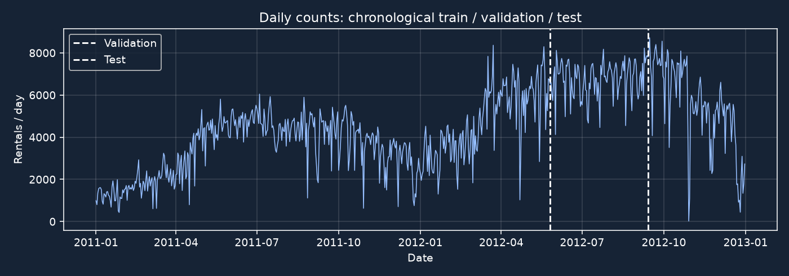
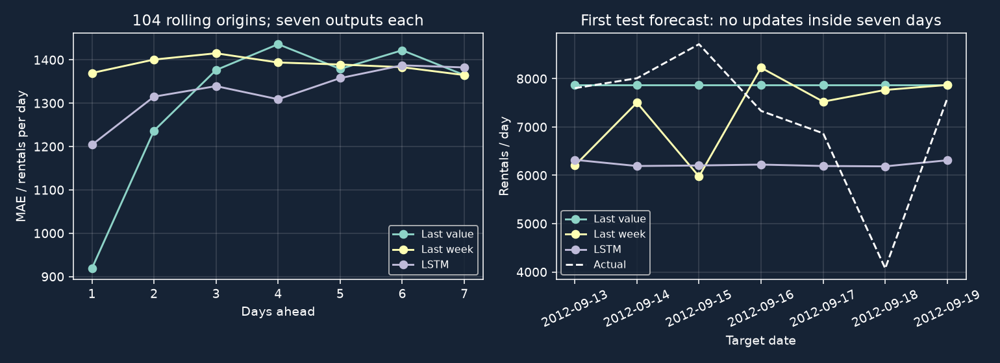

# 7-Day LSTM Forecasting with PyTorch

A seven-day forecast must cover the whole week using the information available at its start. The LSTM here reads 14 observed days and forecasts the next 7 days in one call. The exercise uses real bike-rental data, chronological windows, CPU training and error comparisons by forecast horizon. Basic Python, arrays and a train/validation split are enough to follow along.

The [one-day tutorial](/blog/2026-10-28-lstm_forecasting_tutorial/) covers a shorter horizon. Here, all seven predictions use counts observed through the forecast origin. The default run's pooled test MAE was 1,327.8 rentals per day, versus 1,304.8 for repeating the last value. The simpler baseline had the lower pooled error.

Tested on 2026-10-30: Python 3.12.13, PyTorch 2.14.0, pandas 3.1.0, NumPy 2.5.4, scikit-learn 1.9.1 and Matplotlib 3.11.0, macOS Apple M5, one CPU thread. Training took about one second. One end-to-end invocation including data download took 7.61 seconds and peaked at approximately 441 MiB resident memory; package installation is excluded. No account, API key, GPU or pretrained weights are needed.

## 1. Set up a small CPU experiment

Download [lstm_7day.py](/assets/code/lstm_7day/lstm_7day.py) and [requirements.txt](/assets/code/lstm_7day/requirements.txt) into an empty folder. With Python 3.12 installed, the macOS/Linux commands are:

```bash
python3.12 -m venv .venv
source .venv/bin/activate
python -m pip install -r requirements.txt
python lstm_7day.py
```

The script writes CSVs and plots under `results/`. Alternatively, run every Python block below in order in one process; these are the same script split into stages. The default seed is 0. The CPU and deterministic-algorithm settings support repeat runs in this environment.

```python
import copy
import hashlib
import io
import json
import os
from pathlib import Path
import platform
import time
import urllib.request
import zipfile
import matplotlib
matplotlib.use('Agg')
import matplotlib.pyplot as plt
import numpy as np
import pandas as pd
import torch
from sklearn.preprocessing import StandardScaler
from torch import nn
from torch.utils.data import DataLoader, TensorDataset

WINDOW, HORIZON, EPOCHS = 14, 7, 80
SEED = int(os.environ.get('LSTM_SEED', '0'))
OUT = Path(os.environ.get('LSTM_OUTPUT_DIR', 'results'))
OUT.mkdir(parents=True, exist_ok=True)
torch.manual_seed(SEED)
np.random.seed(SEED)
torch.set_num_threads(1)
torch.use_deterministic_algorithms(True)
plt.style.use('dark_background')
plt.rcParams.update({'figure.facecolor': '#162335', 'axes.facecolor': '#162335',
                     'axes.grid': True, 'grid.alpha': .15})
print(f'Python {platform.python_version()} | torch {torch.__version__} | pandas {pd.__version__} | seed {SEED}')
```

## 2. Load daily rental counts

Use Hadi Fanaee-T's [UCI Bike Sharing dataset](https://archive.ics.uci.edu/dataset/275/bike+sharing+dataset), DOI [10.24432/C5W894](https://doi.org/10.24432/C5W894), CC BY 4.0. We use only `day.csv` and its daily count `cnt`. The 731 dates run from 2011-01-01 through 2012-12-31. The ZIP hash is pinned so a different or corrupt cache does not silently change the exercise.

Only past rental counts enter the model. Same-day `casual` and `registered` sum to the target, and future actual weather is not available at forecast time; neither belongs in this input.

```python
url = 'https://archive.ics.uci.edu/static/public/275/bike+sharing+dataset.zip'
archive = OUT / 'bike_sharing.zip'
if not archive.exists():
    request = urllib.request.Request(url, headers={'User-Agent': 'SevenDayLSTM/1.0'})
    with urllib.request.urlopen(request, timeout=60) as response:
        archive.write_bytes(response.read())
assert hashlib.sha256(archive.read_bytes()).hexdigest() == 'b70182d0d0508e9abbb79306ce5c0cec34869000f8220175ac83d11dbe845401'
with zipfile.ZipFile(io.BytesIO(archive.read_bytes())) as zipped:
    df = pd.read_csv(zipped.open('day.csv'), parse_dates=['dteday'])
df = df.sort_values('dteday').set_index('dteday')
assert df.index.is_unique and df.index.is_monotonic_increasing
assert df.index.to_series().diff().iloc[1:].eq(pd.Timedelta(days=1)).all()
assert df['cnt'].notna().all() and df['cnt'].ge(0).all()
values = df[['cnt']].to_numpy(dtype=np.float32)
train_end, val_end = int(len(df) * .70), int(len(df) * .85)
print('Rows:', len(df), '| raw split boundaries:', train_end, val_end)
```

```text
Rows: 731 | raw split boundaries: 511 621
```

## 3. Plot the chronological split

The earliest 511 raw dates are training, the next 110 validation and the last 110 test. Plot them before fitting a scaler or model. A row means one day only after the consecutive-date assertion has passed.

```python
fig, ax = plt.subplots(figsize=(10, 3.5))
ax.plot(df.index, values[:, 0], lw=.8, color='#96bfff')
for index, label in [(train_end, 'Validation'), (val_end, 'Test')]:
    ax.axvline(df.index[index], ls='--', label=label)
ax.set(xlabel='Date', ylabel='Rentals / day', title='Daily counts: chronological train / validation / test')
ax.legend()
fig.tight_layout()
fig.savefig(OUT / 'timeline.png', dpi=140)
plt.close(fig)
```



## 4. Create fourteen-day inputs and seven-day targets

Let `t` be the first predicted date. Input rows are `t-14` through `t-1`; target rows are `t` through `t+6`. The forecast origin is date `t-1`, the last day observed.

**Fit the scaler on training rows only, and keep all seven targets in their own split.** Exclude windows with targets crossing a boundary, including a window whose first target is in training and whose final target enters validation.

```python
scaler = StandardScaler().fit(values[:train_end])
scaled = scaler.transform(values).astype(np.float32)
t = np.arange(WINDOW, len(values) - HORIZON + 1)
X = np.stack([scaled[i-WINDOW:i] for i in t])
y = np.stack([scaled[i:i+HORIZON, 0] for i in t])
masks = [t + HORIZON <= train_end,
         (t >= train_end) & (t + HORIZON <= val_end), t >= val_end]
(X_train, y_train), (X_val, y_val), (X_test, y_test) = [
    (torch.from_numpy(X[m]), torch.from_numpy(y[m])) for m in masks]
assert np.array_equal(X[0, :, 0], scaled[:WINDOW, 0])
assert np.array_equal(y[0], scaled[WINDOW:WINDOW+HORIZON, 0])
assert (t[masks[0]][-1] + HORIZON - 1) < train_end
assert (t[masks[1]][-1] + HORIZON - 1) < val_end
for name, xx, yy in [('Train', X_train, y_train), ('Validation', X_val, y_val), ('Test', X_test, y_test)]:
    print(name + ':', tuple(xx.shape), tuple(yy.shape))
print('Windows omitted at split boundaries:', len(t) - sum(int(m.sum()) for m in masks))
```

```text
Train: (491, 14, 1) (491, 7)
Validation: (104, 14, 1) (104, 7)
Test: (104, 14, 1) (104, 7)
Windows omitted at split boundaries: 12
```

Each boundary omits six potential windows whose targets would straddle it. Validation and test inputs may still use observations from the preceding split: those are already in the past at their origins.

## 5. Define an LSTM with a seven-output head

The LSTM reads 14 observations. A linear head takes its final hidden vector and returns seven outputs at once. A single model produces this multi-output direct forecast in one forward pass.

`batch_first=True` makes the input shape `(samples, timesteps, features)`. For the dimensions themselves, see [LSTM input shapes](/blog/2026-10-05-lstm_input_shape/). Each window starts with a fresh hidden state. The loader can therefore shuffle the completed training windows while their dates and split membership stay fixed. The [PyTorch LSTM reference](https://docs.pytorch.org/docs/2.14/generated/torch.nn.LSTM.html) documents the sequence output used below.

```python
class SevenDayLSTM(nn.Module):
    def __init__(self):
        super().__init__()
        self.lstm = nn.LSTM(1, 16, batch_first=True)
        self.head = nn.Linear(16, HORIZON)

    def forward(self, x):
        sequence, _ = self.lstm(x)
        return self.head(sequence[:, -1])

model = SevenDayLSTM()
loader = DataLoader(TensorDataset(X_train, y_train), batch_size=32, shuffle=True)
optimizer = torch.optim.Adam(model.parameters(), lr=.003)
loss_fn = nn.MSELoss()
print('Parameters:', sum(p.numel() for p in model.parameters()))
```

```text
Parameters: 1335
```

## 6. Select a checkpoint on seven-day validation error

Training minimizes MSE on standardized targets. After each epoch, validation measures MAE over all origin/horizon pairs and selects the saved weights. Copy the state so it does not keep changing with subsequent optimizer steps. Test data has no role in this choice.

```python
best_val, best_epoch, best_state = float('inf'), 0, None
history = []
started = time.perf_counter()
for epoch in range(1, EPOCHS + 1):
    model.train()
    for xb, yb in loader:
        optimizer.zero_grad()
        loss = loss_fn(model(xb), yb)
        loss.backward()
        optimizer.step()
    model.eval()
    with torch.no_grad():
        val_mae = (model(X_val) - y_val).abs().mean().item()
    history.append([epoch, val_mae * scaler.scale_[0]])
    if val_mae < best_val:
        best_val, best_epoch = val_mae, epoch
        best_state = copy.deepcopy(model.state_dict())
training_seconds = time.perf_counter() - started
model.load_state_dict(best_state)
model.eval()
print(f'Best epoch: {best_epoch}; validation MAE: {best_val * scaler.scale_[0]:.1f}')
print(f'Training only: {training_seconds:.2f} s (one CPU thread)')
```

```text
Best epoch: 14; validation MAE: 880.5
```

The run completes 80 epochs and restores epoch 14, selected by the lowest validation MAE.

## 7. Compare LSTM errors with two simple forecasts

At each test origin, predict seven days without receiving any actual count from those seven days. Compare with two rules that use only information already available at that origin:

- Last value: repeat the last observed count for all seven horizons.
- Last week: reuse the seven observed counts immediately before the forecast, aligned by weekday.

The model weights stay frozen. When the forecast origin advances by one day, yesterday's actual count becomes available for the new input window. This rolling-origin evaluation advances through the 110-day test interval with a new seven-day forecast at each origin.

```python
test_t = t[masks[2]]
with torch.no_grad():
    lstm = model(X_test).numpy() * scaler.scale_[0] + scaler.mean_[0]
actual = np.stack([values[i:i+HORIZON, 0] for i in test_t])
forecasts = {'Last value': np.repeat(values[test_t-1], HORIZON, axis=1),
             'Last week': np.stack([values[i-7:i, 0] for i in test_t]), 'LSTM': lstm}
assert actual.shape == lstm.shape == (len(test_t), HORIZON)
scores = {}
records = []
print('Method       h1      h2      h3      h4      h5      h6      h7     Mean')
for name, prediction in forecasts.items():
    errors = np.abs(actual - prediction)
    by_horizon = errors.mean(axis=0)
    scores[name] = dict(horizon=by_horizon.tolist(), mean=float(errors.mean()))
    print(f'{name:11s} ' + ' '.join(f'{v:7.1f}' for v in by_horizon) + f'  {errors.mean():7.1f}')
for j, i in enumerate(test_t):
    for h in range(HORIZON):
        records.append(dict(origin=str(df.index[i-1].date()), target=str(df.index[i+h].date()),
                            horizon=h+1, actual=float(actual[j, h]),
                            **{name: float(pred[j, h]) for name, pred in forecasts.items()}))
pd.DataFrame(records).to_csv(OUT / 'predictions.csv', index=False)
pd.DataFrame(history, columns=['epoch', 'validation_mae']).to_csv(OUT / 'history.csv', index=False)
summary = dict(seed=SEED, best_epoch=best_epoch, training_seconds=training_seconds, scores=scores,
               origins=len(test_t), first_origin=str(df.index[test_t[0]-1].date()),
               last_origin=str(df.index[test_t[-1]-1].date()))
(OUT / 'summary.json').write_text(json.dumps(summary, indent=2) + '\n')
print('Forecast origins:', summary['origins'], summary['first_origin'], 'to', summary['last_origin'])
```

| Method | Day 1 MAE | Day 4 MAE | Day 7 MAE | Pooled 7-day MAE |
|---|---:|---:|---:|---:|
| Last value | 918.8 | 1436.1 | 1364.8 | 1304.8 |
| Last week | 1369.6 | 1393.9 | 1364.8 | 1388.0 |
| LSTM, seed 0 | 1203.9 | 1309.1 | 1382.4 | 1327.8 |

The test has 104 origins, 2012-09-12 through 2012-12-24. Each produces seven forecasts. The 728 origin/horizon pairs overlap in target dates. The pooled score weights those origin/horizon pairs, so dates that occur in several pairs contribute several times. The overlap creates dependence across the 104 forecasts; no independence-based confidence interval is reported.

## 8. Inspect horizons and one concrete week

The first panel shows errors separately by horizon. The second shows the first test forecast, made after 2012-09-12 for September 13–19. The code fixes that date to the first test origin.

```python
fig, axes = plt.subplots(1, 2, figsize=(11, 4))
for name, prediction in forecasts.items():
    axes[0].plot(range(1, HORIZON+1), scores[name]['horizon'], marker='o', label=name)
    axes[1].plot(df.index[test_t[0]:test_t[0]+HORIZON], prediction[0], marker='o', label=name)
axes[0].set(xlabel='Days ahead', ylabel='MAE / rentals per day', title='104 rolling origins; seven outputs each')
axes[1].plot(df.index[test_t[0]:test_t[0]+HORIZON], actual[0], color='white', ls='--', label='Actual')
axes[1].set(xlabel='Target date', ylabel='Rentals / day', title='First test forecast: no updates inside seven days')
for ax in axes:
    ax.legend(fontsize=8)
axes[1].tick_params(axis='x', rotation=25)
fig.tight_layout()
fig.savefig(OUT / 'forecast_results.png', dpi=140)
plt.close(fig)
```



The LSTM did better than repeating the last count at some middle horizons, but worse on day 1 and slightly worse on day 7. A single pooled number hides that distinction. The two baseline day-7 scores coincide because both rules use the last observed count for that horizon.

## Vary the input window using validation error

Additional runs with seeds 1 and 2 gave pooled LSTM MAEs of 1,309.8 and 1,262.2. The baseline remains 1,304.8. The default remains seed 0. The additional runs show sensitivity to initialization; their test scores were kept out of seed selection. Both runs and their validation-selected epochs are in the [seed output](/assets/code/lstm_7day/seed_sensitivity.txt). Repeating seed 0 reproduced the prediction and history CSVs exactly on this machine.

Try changing `WINDOW` from 14 to 28, or changing the hidden size. Rebuild the windows and retrain, using validation to compare choices. Once the test results have influenced a choice, do not describe a rerun on that same test as a fresh unbiased performance estimate. A longer forecast horizon also needs a reconsidered baseline; do not simply change `HORIZON` and assume the seven-day weekday rule still fits.

The dataset is small, only past counts are inputs, and the model has no calendar or weather forecast features. The reported execution times and exact repeat-run results come from one M5 CPU environment; runtime and numerical variation across other platforms remain untested. The exercise evaluates a small seven-output model on this dataset, leaving performance on broader demand-forecasting tasks unmeasured. For the broader choice between recursive and direct strategies, see [the multi-step forecasting comparison](/blog/2026-10-26-multistep_forecasting/).

The full [recorded output](/assets/code/lstm_7day/reference_output.txt), [forecast CSV](/assets/code/lstm_7day/predictions.csv), [summary JSON](/assets/code/lstm_7day/summary.json) and [run notes](/assets/code/lstm_7day/README.txt) let you check the numbers without trusting the plots. Dataset/license and PyTorch references were checked on 2026-10-30. The [cover renderer](/assets/code/tue_wed_figures/render_figures.py) reads the measured horizon errors.
