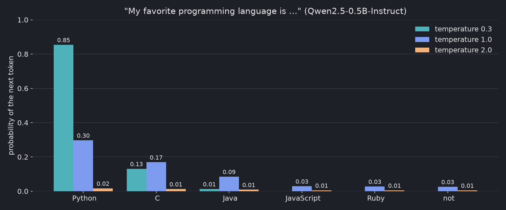

# What does temperature do in an LLM? Temperature, top-k and top-p explained

An LLM picks each next token by sampling from a probability distribution. Temperature sharpens (below 1)
or flattens (above 1) that distribution. Top-k keeps only the k most likely tokens; top-p keeps the smallest set
whose probabilities add up to p. Low temperature gives safe, repetitive text; high temperature gives variety, and past a point, noise.

## How does temperature change the probabilities?

The model outputs a score (logit) for every token in its vocabulary, 151,936 of them for this model.
Temperature divides those scores before softmax. Below 1, the top token gets more probability; above 1, probability spreads to unlikely tokens.

The following experiment ran on 2026-09-28 with the open model Qwen2.5-0.5B-Instruct
(transformers 5.17.0, PyTorch 2.14.0), running locally with no API key.
The model card is [Qwen/Qwen2.5-0.5B-Instruct](https://huggingface.co/Qwen/Qwen2.5-0.5B-Instruct).
The model ran in its default bfloat16 precision; probabilities were computed in float32.
The small model produces weaker text than a commercial model; the sampling settings work the same way.

Here are the real next-token probabilities after "My favorite programming language is" at three temperatures:

```python
import torch
from transformers import AutoModelForCausalLM, AutoTokenizer

name = "Qwen/Qwen2.5-0.5B-Instruct"
tok = AutoTokenizer.from_pretrained(name)
model = AutoModelForCausalLM.from_pretrained(name)
model.eval()

prompt = "My favorite programming language is"
ids = tok(prompt, return_tensors="pt").input_ids
with torch.no_grad():
    logits = model(ids).logits[0, -1].float()    # scores for every possible next token (float32)

top = torch.topk(logits, 6).indices
print(f"prompt: {prompt!r}")
print(f"{'next token':<14}" + "".join(f"{f'T={t}':>9}" for t in [0.3, 1.0, 2.0]))
probs = {t: torch.softmax(logits / t, dim=-1) for t in [0.3, 1.0, 2.0]}
for i in top:
    print(f"{tok.decode(i)!r:<14}" + "".join(f"{probs[t][i].item():>9.3f}" for t in [0.3, 1.0, 2.0]))
```

```
prompt: 'My favorite programming language is'
next token        T=0.3    T=1.0    T=2.0
' Python'         0.854    0.297    0.017
' C'              0.131    0.169    0.013
' Java'           0.013    0.085    0.009
' JavaScript'     0.000    0.029    0.005
' Ruby'           0.000    0.028    0.005
' not'            0.000    0.026    0.005
```



At temperature 0.3, " Python" gets 85% of the probability. At 2.0 it gets 1.7%, and the six most likely tokens together get only 5.4%.
The rest is spread across tens of thousands of unlikely tokens:

```python
# continues from the code above (logits)
print(f"vocabulary size: {logits.numel():,}")
print(f"{'T':>4}{'top-6 mass':>12}{'tokens for top-p 0.9':>22}")
for t in [0.3, 1.0, 2.0]:
    p = torch.sort(torch.softmax(logits / t, dim=-1), descending=True).values
    n90 = int((torch.cumsum(p, 0) < 0.9).sum()) + 1
    print(f"{t:>4}{p[:6].sum().item():>12.3f}{n90:>22,}")
```

```
vocabulary size: 151,936
   T  top-6 mass  tokens for top-p 0.9
 0.3       1.000                     2
 1.0       0.635                    64
 2.0       0.054                43,942
```

To cover 90% of the probability, you need 2 tokens at temperature 0.3, 64 at 1.0, and 43,942 at 2.0.

## Compare generated text across temperatures

Three samples per temperature, each with a fixed random seed:

```python
# continues from the code above (model, tok, ids)
for t in [0.3, 1.0, 2.0]:
    print(f"--- temperature {t}")
    for seed in range(3):
        torch.manual_seed(seed)
        out = model.generate(ids, do_sample=True, temperature=t, top_k=0, top_p=1.0,
                             max_new_tokens=12, pad_token_id=tok.eos_token_id)
        print("  ", repr(tok.decode(out[0, ids.shape[1]:], skip_special_tokens=True)))
```

```
--- temperature 0.3
   ' Python. I am learning to code and have been trying to'
   ' Python. What are some of the benefits and drawbacks of using'
   " C++. I'm trying to learn Python. Can you provide"
--- temperature 1.0
   " Python. Let's say I have two lists of integers:\n\n"
   ':\nrunning\n\nThis justifies why we use "running"'
   ' C#. This language reacts promptly with Linq queries, so'
--- temperature 2.0
   ' ZAAA.\\憩 שנית consumptionkubectl品尝pellier啦 CFRAs'
   ':\nrunning South Hercules Üniversitesi \ndiscussion allowed;\nlongitude 필 관'
   ' Dart弨 recorder reacts bc subtotal MSR序列ues对 yüz'
```

`top_k=0, top_p=1.0` turns both filters off. These earlier calls retain the model's saved repetition penalty;
the added measurements below explicitly fix that setting. At 2.0, the model samples from the long tail and mixes random words from many languages.

## Top-k and top-p after temperature scaling

Top-k cuts the candidates to a fixed number. Top-p (nucleus sampling) cuts them to a probability budget.
In this experiment, top-k kept the generated text readable at high temperature, while top-p left the output noisy:

```python
# continues from the code above (model, tok, ids)
settings = {"T=2.0, top_k=20": dict(temperature=2.0, top_k=20, top_p=1.0),
            "T=2.0, top_p=0.9": dict(temperature=2.0, top_k=0, top_p=0.9)}
for label, kw in settings.items():
    print(f"--- {label}")
    for seed in range(3):
        torch.manual_seed(seed)
        out = model.generate(ids, do_sample=True, max_new_tokens=12, pad_token_id=tok.eos_token_id, **kw)
        print("  ", repr(tok.decode(out[0, ids.shape[1]:], skip_special_tokens=True)))
```

```
--- T=2.0, top_k=20
   ' Python. My colleagues have said there is one key reason their'
   ' Go. But now with new tools for the latest releases like'
   ' C#. This year, more and more businesses adopt Java in'
--- T=2.0, top_p=0.9
   ' ZAAA.\\憩民愈趋品尝各种各样啦 CFRAs'
   ':\nrunning South Hercules Üniversitesi \ndiscussion allowed;\nlongitude是多少显示'
   ' Dart– pirate recorder reacts promptly)], Fury tidues rapid yüz'
```

The reason is the order. transformers applies temperature first, then top-k, then top-p (we checked its logits processor list:
`TemperatureLogitsWarper`, `TopKLogitsWarper`, `TopPLogitsWarper`). After temperature 2.0 has flattened the distribution,
"the top 90%" still contains about 44,000 tokens, so top-p removes almost nothing. Top-k=20 keeps exactly 20, no matter how flat the distribution is.
Hugging Face's [Generation strategies](https://huggingface.co/docs/transformers/generation_strategies)
documentation describes these sampling controls (checked 2026-09-28).

## Temperature zero and greedy decoding

In transformers 5.17.0, sampling with `temperature=0.0` raises a `ValueError`. With `num_beams=1`,
`do_sample=False` selects greedy decoding and leaves temperature out of the logits processing.
The installed [`TemperatureLogitsWarper` source](https://github.com/huggingface/transformers/blob/v5.17.0/src/transformers/generation/logits_process.py)
requires a positive float, and the [generation documentation](https://huggingface.co/docs/transformers/v5.17.0/en/main_classes/text_generation)
describes greedy decoding and sampling (both checked 2026-11-23).

The added checks use the same raw prompt and model as above. The cached snapshot is pinned in the
[measurement script](/assets/code/llm_temperature/sampling_measurements.py), with CPU bfloat16 weights and eager attention,
transformers 5.17.0, PyTorch 2.14.0 and Python 3.12.13 on macOS arm64, tested 2026-11-23.
The original loader left revision implicit; the new script records the snapshot and complete settings in its results.
The model's saved generation settings include `repetition_penalty=1.1`, `top_k=20` and `top_p=0.8`.
For these checks, the script fixes `repetition_penalty=1.0`, `top_k=0`, `top_p=1.0`, `num_beams=1`,
`max_new_tokens=12` and `use_cache=True`. It preserves both model EOS IDs and uses the tokenizer EOS as padding.

Save the linked script beside the code below so that its loader and configuration helper can be imported:

```python
import torch
from sampling_measurements import load, generate

model, tok, inputs, config = load()
try:
    generate(model, inputs, config, do_sample=True, temperature=0.0)
except ValueError as exc:
    print('sampling temperature=0:', type(exc).__name__)
    print(str(exc))
with torch.inference_mode():
    zero = generate(model, inputs, config, do_sample=False, temperature=0.0)
    one = generate(model, inputs, config, do_sample=False, temperature=1.0)
print('greedy temperature=0 equals temperature=1:', torch.equal(zero, one))
print('greedy continuation:', repr(tok.decode(zero[0, inputs.input_ids.shape[1]:], skip_special_tokens=True)))
```

```text
sampling temperature=0: ValueError
`temperature` (=0.0) has to be a strictly positive float, otherwise your next token scores will be invalid. If you're looking for greedy decoding strategies, set `do_sample=False`.
greedy temperature=0 equals temperature=1: True
greedy continuation: ' Python. I am a beginner and I am trying to learn'
```

The two greedy calls produced identical token IDs. Transformers also logged that the sampling-only flags
`temperature` and `top_k` may be ignored in the greedy call; the saved warning lines accompany the raw output.
For greedy generation, set `do_sample=False` and leave sampling controls at their defaults.

## Measure twenty continuations per temperature

The same raw prompt, `"My favorite programming language is"`, was sampled once for each seed from 0 through 19 at
each of the three temperatures. Each call generates up to 12 new tokens. Every seed is reset for each temperature;
the prompt, weights and filtering settings stay fixed. The following block continues from the loader above:

```python
from sampling_measurements import diversity

summary, samples = diversity(model, tok, inputs, config)
```

```text
temperature | unique continuations | first tokens | starts with ' Python'
0.3 | 18/20 | 2 | 19/20
1.0 | 20/20 | 18 | 3/20
2.0 | 20/20 | 20 | 0/20
```

| Temperature | Distinct token-ID continuations / calls | Distinct first tokens | First token is ` Python` |
|---|---|---|---|
| 0.3 | 18 / 20 | 2 | 19 / 20 |
| 1.0 | 20 / 20 | 18 | 3 / 20 |
| 2.0 | 20 / 20 | 20 | 0 / 20 |

At the lowest temperature, the first token was ` Python` in nearly every call, but later tokens still varied enough
to produce 18 distinct continuations. At both higher temperatures, every continuation was distinct in this sample.
The first-token vocabulary expanded from 2 to 18 to 20 observed token IDs. The
[complete samples and token IDs](/assets/code/llm_temperature/sampling_results.json) retain every continuation,
and the [recorded stdout](/assets/code/llm_temperature/reference_output.txt) contains the measured counts.

These counts describe one prompt, a small model, 20 seeds and a short token budget. They measure observed variety;
answer usefulness and correctness were not scored. The count of distinct continuations already reaches the sample
size at both higher temperatures, so it cannot distinguish their variety further with this sample size.

## Choose sampling settings for the task

For factual or code tasks, use low temperature. For brainstorming, a moderate temperature around 0.7–1.0 with top-p or top-k
gives variety; the table also includes a higher range for creative writing.

| Task | Temperature | Filter | Why |
|---|---|---|---|
| Extracting facts, classification, code | 0–0.3 | — | You want the single most likely answer, every time |
| General chat, explanations | 0.7–1.0 | top-p 0.9 or top-k 40 | Natural variety without drifting |
| Brainstorming, creative writing | 1.0–1.2 | top-k or top-p | More variety; check the output |
| Anything | above ~1.5 | — | Tends toward noise, as shown above |

Different APIs use different defaults and may apply these settings in a different order, so test on your own prompts.

For the units being sampled, see [What is a token, and why do LLMs count tokens instead of words?](/tips/2026-09-29-what_is_a_token/).
