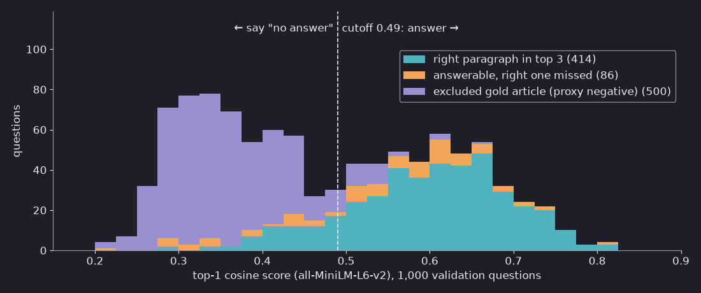

# Cosine similarity is not confidence: choosing a retrieval threshold

A retrieval step always returns *something*. Ask a document search about a topic it has never seen and the top result
still comes back with a cosine score, say 0.45. A common fix is a cutoff: "if the best score is below X, answer
'I don't know'". The trouble is choosing X. A cosine score is **not a probability**: 0.45 does not mean 45% sure, and
the same score means different things for different models.

This Tip measures it. We pick the cutoff on validation questions, check it once on separate test questions, and then
swap the embedding model. In short: with all-MiniLM-L6-v2, the cutoff that gave 80% precision on validation was 0.49. On the test questions it gave 67.6%. Another model needed a cutoff of 0.67 for the same target, and applying MiniLM's 0.49 to it answered 99% of questions at 41% precision.

## The setup: include or exclude the annotated source

[Embeddings](/tips/2026-10-01-embeddings_semantic_search/) turn text into vectors, and cosine similarity compares two
of them: 1 means the same direction and 0 means orthogonal, not necessarily semantically unrelated.
The data is the [SQuAD v1.1](https://rajpurkar.github.io/SQuAD-explorer/)
dev set (CC BY-SA 4.0): 48 Wikipedia articles, each split into paragraphs, with questions written about each
paragraph.

We create proxy-negative questions by leaving whole articles out of the search corpus:

- Shuffle the 48 articles (seed 0). Put the paragraphs of 32 of them in the corpus.
- Answerable questions come from those 32 articles. Each was written about one paragraph, its *right* paragraph.
- Proxy-negative questions come from the other 16 articles. Their annotated paragraph is absent, so any returned
  bundle counts as a miss under this exact-source protocol. Other indexed paragraphs might still answer them.
- Split by article, not by question: validation uses 16 corpus articles plus 8 left-out articles; test uses the other
  16 plus 8. Sample 500 answerable and 500 unanswerable questions for each.

The code's `answerable` flag means **the annotated source is indexed**. Printed labels such as `no answer in corpus`
and `unanswerable` are shorthand for the excluded-article proxy, not proof that the corpus cannot answer a question.
The experiment measures source retrieval, not generated-answer correctness.

To run it yourself, install the packages from
[`requirements.txt`](/assets/code/cosine_threshold/requirements.txt), download the dev set, and run the blocks below
in order in one Python session. The first run downloads the two models from Hugging Face.

```bash
python -m pip install -r requirements.txt
curl -O https://rajpurkar.github.io/SQuAD-explorer/dataset/dev-v1.1.json
```

```python
import json
import random

import numpy as np
from sentence_transformers import SentenceTransformer

articles = json.load(open("dev-v1.1.json"))["data"]
order = list(range(len(articles)))
random.Random(0).shuffle(order)
groups = {"val": (order[:16], order[32:40]), "test": (order[16:32], order[40:48])}

corpus, questions = [], {}
for split, (in_corpus, left_out) in groups.items():
    answerable, unanswerable = [], []
    for a in in_corpus:
        for p in articles[a]["paragraphs"]:
            corpus.append(p["context"])
            answerable += [(qa["question"], len(corpus) - 1) for qa in p["qas"]]
    for a in left_out:
        unanswerable += [(qa["question"], -1) for p in articles[a]["paragraphs"] for qa in p["qas"]]
    rng = random.Random(1)
    questions[split] = rng.sample(answerable, 500) + rng.sample(unanswerable, 500)
print("corpus paragraphs:", len(corpus))
print({split: len(q) for split, q in questions.items()})
```

```text
corpus paragraphs: 1439
{'val': 1000, 'test': 1000}
```

Next, embed the corpus and the questions with
[all-MiniLM-L6-v2](https://huggingface.co/sentence-transformers/all-MiniLM-L6-v2) (Apache-2.0), on CPU. Suppose the
answer step reads the **top 3 paragraphs**. For each question keep the best cosine score and whether the right
paragraph is among those 3.

```python
def retrieve(model_name, revision, query_prefix=""):
    model = SentenceTransformer(model_name, revision=revision, device="cpu")
    docs = model.encode(corpus, batch_size=64, normalize_embeddings=True)
    result = {}
    for split, qs in questions.items():
        q = model.encode([query_prefix + text for text, _ in qs], batch_size=64, normalize_embeddings=True)
        sims = q @ docs.T  # cosine similarity, because the vectors are normalized
        top3 = np.argsort(-sims, axis=1)[:, :3]
        gold = np.array([g for _, g in qs])
        result[split] = {"score": sims.max(axis=1), "correct": (top3 == gold[:, None]).any(axis=1),
                         "answerable": gold >= 0}
    return result

mini = retrieve("sentence-transformers/all-MiniLM-L6-v2", "1110a243fdf4706b3f48f1d95db1a4f5529b4d41")
v = mini["val"]
for name, mask in [("right one in top 3", v["correct"]),
                   ("right one missed", v["answerable"] & ~v["correct"]),
                   ("no answer in corpus", ~v["answerable"])]:
    print(f"{name:20s} n={mask.sum():3d}  top-1 score median {np.median(v['score'][mask]):.3f}")
```

```text
right one in top 3   n=414  top-1 score median 0.605
right one missed     n= 86  top-1 score median 0.561
no answer in corpus  n=500  top-1 score median 0.349
```



The three groups overlap. Excluded-article questions still have a median best score near 0.35. No cutoff cleanly
separates these retrieval outcomes. The cover plots validation acceptance curves, omitting cutoffs passing fewer
than 20 queries; neither the curves nor their 80% target show generated-answer accuracy.

## Two numbers to watch

For a cutoff `t`, the gate passes a three-paragraph bundle when its **top-1 score** is at least `t`; otherwise it abstains.

- **Coverage:** the share of all queries whose bundle is passed.
- **Acceptance precision:** among passed queries, the share whose bundle contains the annotated paragraph.
  Excluded-article queries count as misses by construction. This query-level measure is **not document precision@3**
  and not answer accuracy. The code shortens its name to `precision`.

A hypothetical perfect retriever and gate could pass all 500 indexed-source queries and reject the 500 proxies:
50% coverage under this labeling protocol. Our actual retriever also misses some indexed sources.

Raising `t` cannot increase coverage, but precision can go up **or down** as queries are removed.
For this illustration, scan the 0.00–0.99 grid at 0.01 intervals for the lowest cutoff meeting an **80% validation target**:

```python
def precision_coverage(t, r):
    if t is None:
        raise ValueError("No validation cutoff met the target; do not evaluate a missing threshold.")
    answered = r["score"] >= t
    precision = r["correct"][answered].mean() if answered.any() else float("nan")
    return precision, answered.mean()

def choose_threshold(r, target=0.80):
    for t in np.round(np.arange(0.0, 1.0, 0.01), 2):
        if precision_coverage(t, r)[0] >= target:
            return t
    return None

for t in [0.3, 0.4, 0.5, 0.6, 0.7]:
    p, c = precision_coverage(t, mini["val"])
    print(f"t={t:.1f}  precision {p:.3f}  coverage {c:.3f}")
t_mini = choose_threshold(mini["val"])
p, c = precision_coverage(t_mini, mini["test"])
print(f"chosen on validation: t={t_mini:.2f}  ->  test precision {p:.3f}, coverage {c:.3f}")
```

```text
t=0.3  precision 0.465  coverage 0.886
t=0.4  precision 0.660  coverage 0.608
t=0.5  precision 0.802  coverage 0.434
t=0.6  precision 0.863  coverage 0.255
t=0.7  precision 0.921  coverage 0.063
chosen on validation: t=0.49  ->  test precision 0.676, coverage 0.490
```

On validation the scan lands at **0.49**: 80.1% acceptance precision over **442 passed queries** (44.2% coverage).
On test it passes **490 queries** (49.0%) with **67.6% acceptance precision**, below the target. Of the 500
excluded-article questions in each split, 84 pass on test versus 29 on validation. The same validation rule did
not transfer to these held-out topics. These sample estimates are not a guaranteed deployment precision.

If no grid point meets the target, `choose_threshold` returns `None`; the evaluation helper raises an explicit
error instead of silently inventing a cutoff. Change the retrieval setup or target using validation evidence,
not by searching the test set for a better number.

Seed 0 was fixed before the run, and it turned out to be the worst of ten article splits. Repeating the whole procedure with split seeds 0 to 9, the chosen cutoff ranged from 0.48 to 0.58 and test precision from 67.6% to 88.2% (median 82.3%). A validation target is an estimate, not a guarantee. Use as much validation data as you can, from the same kind of questions you expect, and recheck after launch.

## A score of 0.5 is not "50% sure"

If best cosine scores were calibrated probabilities of our source-hit event, scores around 0.5 would correspond
to that event about half the time.
Group the validation questions by their top score and count how often the right paragraph was in the top 3:

```python
r = mini["val"]
for lo in [0.2, 0.3, 0.4, 0.5, 0.6, 0.7]:
    in_bin = (r["score"] >= lo) & (r["score"] < lo + 0.1)
    if in_bin.any():
        print(f"score {lo:.1f}-{lo + 0.1:.1f}: n={in_bin.sum():3d}  right paragraph in top 3: "
              f"{r['correct'][in_bin].mean():.0%}")
```

```text
score 0.2-0.3: n=114  right paragraph in top 3: 2%
score 0.3-0.4: n=278  right paragraph in top 3: 4%
score 0.4-0.5: n=174  right paragraph in top 3: 30%
score 0.5-0.6: n=179  right paragraph in top 3: 72%
score 0.6-0.7: n=192  right paragraph in top 3: 84%
score 0.7-0.8: n= 59  right paragraph in top 3: 93%
```

Scores of 0.3 to 0.4 were almost never right (4%), 0.4 to 0.5 were right 30% of the time, and 0.5 to 0.6 were right 72% of the time. If the score were a probability, those bins would sit near 35%, 45% and 55%. This mapping also holds only for this model, corpus and question mix. The score ranks paragraphs for one question; it was not trained to say how likely an answer is to be right.

## Another model, another threshold

Repeat the same steps with [bge-small-en-v1.5](https://huggingface.co/BAAI/bge-small-en-v1.5) (MIT), a model of
similar size from a different family, on the same corpus and questions. Its model card asks for an instruction prefix
on short queries, so we add it:

```python
bge = retrieve("BAAI/bge-small-en-v1.5", "5c38ec7c405ec4b44b94cc5a9bb96e735b38267a",
               query_prefix="Represent this sentence for searching relevant passages: ")
print(f"bge median top score, no answer in corpus: {np.median(bge['val']['score'][~bge['val']['answerable']]):.3f}")
t_bge = choose_threshold(bge["val"])
for label, t in [(f"MiniLM's cutoff {t_mini:.2f}", t_mini), (f"its own cutoff {t_bge:.2f}", t_bge)]:
    p, c = precision_coverage(t, bge["test"])
    print(f"bge with {label}: test precision {p:.3f}, coverage {c:.3f}")
```

```text
bge median top score, no answer in corpus: 0.584
bge with MiniLM's cutoff 0.49: test precision 0.410, coverage 0.990
bge with its own cutoff 0.67: test precision 0.740, coverage 0.470
```

bge's score distribution is higher in this run: its median best score for excluded-article questions is 0.58,
against 0.35 for MiniLM. Reusing 0.49 passes 990 test queries (99.0%) at 41.0% acceptance precision. Its own
validation cutoff, 0.67, passes 470 queries (47.0%) at 74.0%. The [bge model card](https://huggingface.co/BAAI/bge-small-en-v1.5)
likewise recommends choosing a filtering threshold from the score distribution on your own data. These are
two configured pipelines, including bge's query prefix, not a general ranking of model quality.

The mix of questions matters as well. The evaluation above uses 50% excluded-article proxies. In the test set,
keep all 500 indexed-source questions but only 56 proxies (about 10% of the total), and the same MiniLM cutoff
gives a different precision:

```python
r = mini["test"]
keep = np.r_[np.arange(500), 500 + np.arange(56)]
mostly_answerable = {key: value[keep] for key, value in r.items()}
p, c = precision_coverage(t_mini, mostly_answerable)
print(f"t={t_mini:.2f} with ~10% unanswerable: precision {p:.3f}, coverage {c:.3f}")
```

```text
t=0.49 with ~10% unanswerable: precision 0.792, coverage 0.752
```

## How to choose a threshold for your own search

| Setting, held-out test questions | Cutoff | Precision | Coverage |
|---|---|---|---|
| MiniLM, cutoff chosen on its validation | 0.49 | 67.6% | 49.0% |
| MiniLM, same cutoff, ~10% excluded-article proxies | 0.49 | 79.2% | 75.2% |
| bge, MiniLM's cutoff reused | 0.49 | 41.0% | 99.0% |
| bge, cutoff chosen on its validation | 0.67 | 74.0% | 47.0% |
| MiniLM, cutoff 0.20 (answers almost everything) | 0.20 | 40.0% | 99.7% |

1. **Label a validation set from your own traffic,** including questions your documents cannot answer. The share of
   those questions changes precision, so use a realistic mix.
2. **Define success:** an acceptance-precision or coverage target, and whether success means a source hit or a correct answer.
3. **Scan cutoffs on validation only,** then check the chosen cutoff once on separate test questions.
4. **Choose it again** when you change the embedding model, the chunking, or the documents. A cutoff from a blog post,
   including this one, is not a default for your system.

The cutoff only controls whether you answer. It does not turn the score into a probability. If you need a calibrated
"how likely is this right" number, fit and evaluate a calibration model with appropriately separated labeled data.
A [cross-encoder reranker](/tips/2026-10-29-rag_reranking/) can change the ranking, but does not automatically
calibrate its scores into probabilities either. Its scores need their own validation.

## Limits of this experiment

- One dataset, two models. SQuAD questions reuse many words from their paragraph, and MiniLM's training data
  includes the SQuAD 2.0 training set, per its model card. Questions from real users may be harder; we did not test
  that.
- "Right" means the paragraph the question was written for is in the top 3. Another paragraph may also contain
  the answer and is counted as wrong, so precision here leans low. Left-out articles could also share facts with the
  corpus.
- The gate looks only at the best score. It does not check whether the answer step actually uses the paragraph.
- The setup was revised once after a first look at this data. Counting only the single best paragraph, no cutoff
  reached 80% precision on validation, so we switched to the top-3 rule and set the 80% target. bge was chosen as the
  second model because its scores sit on a visibly different scale; the size of the gap depends on the models compared.
- 500 + 500 questions per split. Across all ten article splits (seeds 0–9), cutoffs ranged from 0.48 to 0.58 and
  test acceptance precision from 67.6% to 88.2%; seed 0 was the lowest. These overlapping split experiments
  are a sensitivity check, not ten independent samples or a confidence interval.

_Tested on 2026-11-01 with Python 3.12.13, sentence-transformers 6.2.0, transformers 5.22.1, PyTorch 2.15.0 (CPU) and NumPy 2.5.4 on
macOS, Apple M5. The full script, including both models, the chart and the ten-split check, took 106 to 123 seconds on CPU in three runs with the models already downloaded, and peaked under 2.1 GiB resident memory. Model revisions are pinned in the code.
[`cosine_threshold.py`](/assets/code/cosine_threshold/cosine_threshold.py) also writes the scores and chart data;
its recorded output is in [`reference_output.txt`](/assets/code/cosine_threshold/reference_output.txt)._

For other ways to improve what retrieval returns, see
[hybrid search with BM25](/tips/2026-10-30-hybrid_search_bm25/).
